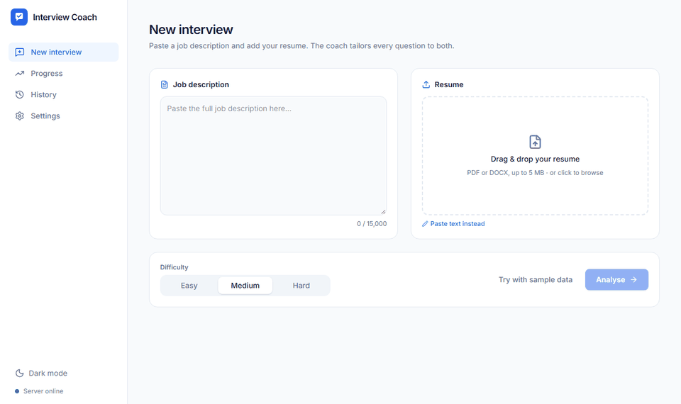
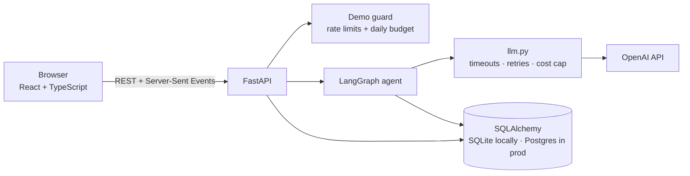
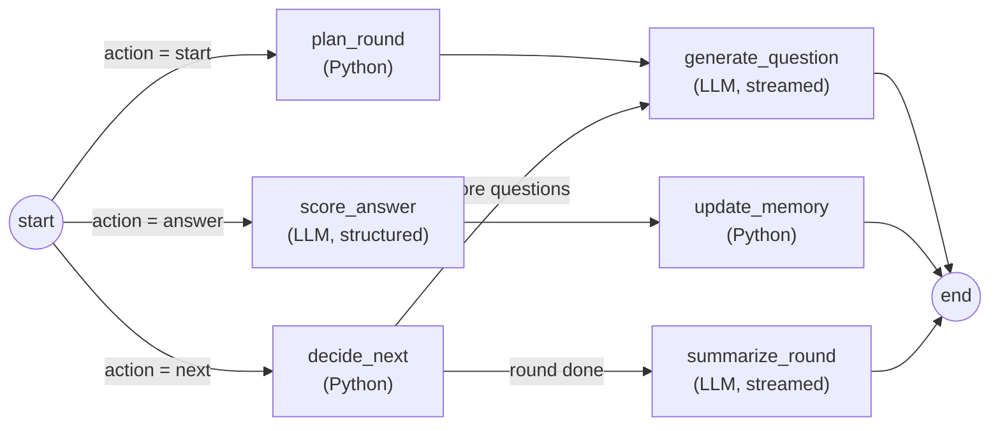

# Interview Coach

**An AI mock interviewer for data science and ML roles.** Paste a job description and your resume;
the agent interviews you one question at a time, scores every answer against a rubric, shows a
stronger sample answer, and **remembers your weak topics** so later rounds focus on them.

[](https://github.com/Purandhar-Srikanth/interview-coach/actions/workflows/ci.yml)
[](https://interview-coach-tgse.onrender.com)
[](LICENSE)

**▶ Live demo: <https://interview-coach-tgse.onrender.com>** (2 free rounds per visitor per day;
the free server sleeps when idle, so the first visit can take ~50 s to wake up)



<sub>Demo recorded with the built-in mock model so it's reproducible (`frontend/scripts/record-demo.mjs`).
The live demo uses real OpenAI models.</sub>

---

## What it does

- **Tailored interviews.** Reads the JD and resume (PDF/DOCX drag-and-drop or paste), extracts the
  role, key skills, interview topics and resume projects, then plans a 5-question round:
  a project deep-dive, technical/SQL/Python/ML questions, and a behavioural question.
- **Rubric scoring with feedback.** Every answer gets 1–5 scores on **correctness** (or **STAR
  structure** for behavioural answers), **depth**, **clarity** and **relevance to the JD**, combined
  into a score out of 100, plus what went well, what to improve, a stronger sample answer and the
  points a strong answer covers.
- **Memory of weak areas.** A per-topic moving average is stored after every first attempt; the
  planner puts topics averaging below 70 first in the next round. One click starts a
  **focused round** on a weak topic.
- **Feels like a product.** Streaming (typing) questions, soft answer timer, skip/retry, keyboard
  shortcuts, **voice answers** (browser speech recognition), animated score reveal, progress
  charts, session history, dark mode, mobile layout, and "delete my data".

## How it works



The agent is a LangGraph state graph that runs **once per user action**. The database is the
source of truth, so nothing is kept in memory between requests (server restarts lose nothing).



**LLMs only where judgement is needed** (writing questions, scoring, summarising); planning,
memory and routing are plain Python with unit tests.

| Step | Model | Why |
|---|---|---|
| Score answers | `gpt-6.1-terra` | quality matters most; structured outputs (JSON schema) |
| Questions, profile analysis, summary | `gpt-6-luna` | ~10× cheaper; tightly guided prompts |

Models are set in `.env` and only `backend/app/llm.py` talks to OpenAI, so swapping them is one line.

### Keeping scores consistent
Anchored 1–5 level descriptions · a one-sentence justification written **before** each score ·
JSON-schema structured outputs · reference-guided grading (key points written with the question
are given to the scorer) · fixed, low reasoning effort · and an [eval set](evals/) to measure it.

## Results

**Live end-to-end test** (one real round on the deployed site, real models):

| | |
|---|---|
| Question tailoring | e.g. *"For your **Customer Churn Predictor**, how did you choose the evaluation metric and handle class imbalance…?"* |
| Score separation | strong, specific answer **84–90** · vague "I'm not sure" **0** · off-topic answer flagged as not answering |
| Latency | first words of a question in **1.4–2.6 s**; scoring **7–10 s**; summary **< 3 s** |
| Cost | **$0.02 per 5-question round** (so the $1/day demo cap ≈ 50 rounds) |

**Scoring evals** ([evals/](evals/)): 21 hand-labelled answers (7 questions × weak/average/strong),
each scored 3× with the production scorer, measuring ranking accuracy, band agreement,
consistency (std dev) and per-dimension stability. The harness runs in CI with mock scores;
run it against the real model with `.venv\Scripts\python evals\run_evals.py` (~$0.20). Results
are written to `evals/results.md`.

## Quick start

Needs Python 3.12+ and Node 20+ (PowerShell 7 for the scripts).

```powershell
& .\scripts\setup.ps1    # venv + packages + a .env in mock mode (no API key, no cost)
& .\scripts\run.ps1      # builds the UI and starts everything at http://localhost:8000
```

Use real models: `& .\scripts\set_openai_key.ps1` (saves your key to the gitignored `.env`
with hidden input). Settings and limits are documented in [.env.example](.env.example).

<details><summary>Development mode (instant reload) and tests</summary>

```powershell
# terminal 1: API on :8000
.\.venv\Scripts\python -m uvicorn app.main:app --reload --port 8000 --app-dir backend
# terminal 2: UI on :5173 (proxies /api to :8000)
npm --prefix frontend run dev

# backend: 64 tests with a fake LLM (free, offline) + lint
cd backend; ..\.venv\Scripts\python -m pytest -q; ..\.venv\Scripts\ruff check .
# end-to-end browser tests (Playwright, mock LLM)
npm --prefix frontend run build; npm --prefix frontend run e2e
```
</details>

## Tech stack

| Layer | Choice | Why |
|---|---|---|
| Agent | LangGraph | explicit, testable graph with conditional routing and streamed events |
| Backend | FastAPI, SQLAlchemy, Pydantic | typed APIs, SSE streaming, same code on SQLite and Postgres |
| LLM | OpenAI Responses API | structured outputs for scores; streaming of a JSON field for the typing effect |
| Frontend | React, TypeScript, Vite, Tailwind, Recharts, Motion | real interactivity, charts, animations |
| Quality | pytest, Playwright, ruff, oxlint, GitHub Actions | 64 unit/API tests, 4 browser tests, Docker build check, eval dry run |
| Hosting | Render (Docker, free) + Neon Postgres | auto-deploys on push to `main` |

## Safety, cost and privacy

- The API key lives only on the server (`.env` locally, a Render secret in production), never in
  the browser or the repo.
- Every LLM call is refused **before** it's sent if its worst-case cost could exceed the
  **$0.25 per-session cap**; the public demo also has a **$1/day global budget**, per-visitor and
  per-IP round limits, a per-IP rate limit and input size limits. Details: [docs/DEPLOY.md](docs/DEPLOY.md).
- No accounts: an anonymous ID in your browser. Uploaded files are read in memory and never
  stored; OpenAI storage is turned off; voice audio goes to the browser's speech service, not our
  server. **Delete my data** removes everything; demo data is purged after 7 days.

## Project structure

```
backend/app/
  agent/       graph.py · nodes.py · planner.py · memory.py · rubric.py · scoring.py · prompts.py · topics.py
  api/         sessions · interview (SSE) · progress · resume · deps
  llm.py       the only OpenAI client: timeouts, retries, budget, friendly errors
  guard.py     demo protection   ·   models.py / db.py   database
frontend/src/  pages/ · components/ · hooks/ (useInterview, useSpeechRecognition) · lib/api.ts
frontend/e2e/  Playwright tests
evals/         scoring eval set and runner
docs/          PLAN.md · DEPLOY.md · media/
```

A guided walkthrough of every file, the design decisions and likely interview questions is in
[INTERVIEW_NOTES.md](INTERVIEW_NOTES.md).

## Limitations and next steps

- Voice input works in Chrome/Edge only (browser speech API); an OpenAI transcription fallback
  would cover other browsers.
- No database migrations yet (tables are created on startup); Alembic would be next.
- Per-IP limits are in memory; a shared store (e.g. Redis) would be needed to run several servers.

## License

[MIT](LICENSE) © 2026 Purandhar Srikanth
